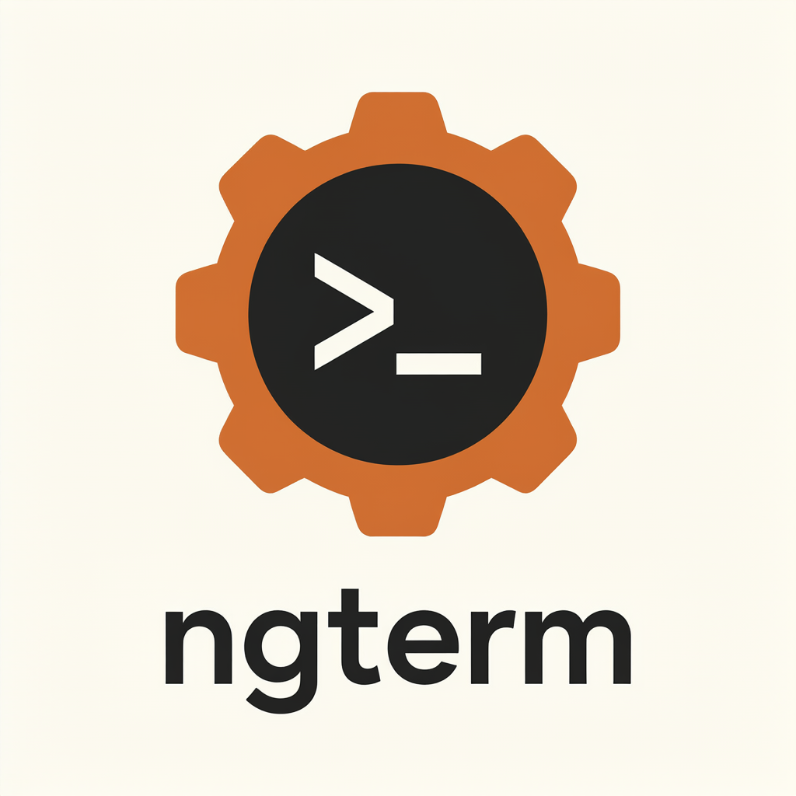

# ngterm

<p align="center"></p>

ngterm: [agterm](https://github.com/umputun/agterm) in Rust, a GPUI terminal over Ghostty's libghostty-vt, driven by
`ngtermctl` over a control socket. macOS, Linux and Windows are equal targets. Today the app is built and tested on
Linux; the terminal core, the pane core and the live-session server under it (libghostty-vt, `ngterm-pty`,
`ngterm-term`, `ngterm-session` and the crates [CI](#ci) lists) build and test on all three
([macOS and Windows](#macos-and-windows)). Everything else below is the Linux build unless it names another OS.

- The Linux build's application id is `com.nickalie.ngterm`, its state dir `$XDG_DATA_HOME/ngterm` (else
  `~/.local/share/ngterm`) with the control socket at `<state dir>/ngterm.sock`, and its config dir `~/.config/ngterm`
  (keymap, hooks, ngterm-scoped ghostty config).
  One instance runs per application id: the first owns the id's name on the session bus and serves `GApplication`'s
  D-Bus protocol there (through `zbus`), and a later launch of this build forwards its activation to it and exits
  before touching the state.
- The binaries are `ngterm`, `ngtermctl` and `ngterm-session`, the crates `ngterm-*`, and every variable the app sets
  or reads is `NGTERM_*` (a pane's `NGTERM_SESSION_ID`, `NGTERM_SOCKET`, `NGTERM_PANE_ID`, the attach contract's
  `NGTERM_LIVE_*`; upstream's are `AGTERM_*`). A reinstall of the agent-status hooks or the skill over one made
  before the build took these names (in `~/.config/agterm/agent-status`) moves it onto them, into
  `~/.config/ngterm/agent-status`: the rc and Codex blocks, the Claude hooks, this build's old Pi and OpenCode plugins
  (agterm's own, at the same paths, stay) and the skill's marker. The old
  `agterm-*` wrappers stay in the package: shells started before the update keep reporting through them, and a config
  the merge could not repoint (a hand-written Codex block) finds them but reports nothing from a new pane until it
  names the `ngterm-*` ones.
- The CLI is `ngtermctl` (upstream's is `agtermctl`), and the Help menu's installers use this build's names too:
  Install Command Line Tool… links the bundled `ngtermctl` into `~/.local/bin` (an `agtermctl` there is left alone),
  and Install Agent Skill… installs the `ngterm` skill, which drives the app through `ngtermctl`, into
  `~/.claude/skills/ngterm` and `~/.codex/skills/ngterm` (an `agterm` skill there is left alone).
- One extension beyond upstream: Live sessions in bash and PowerShell login shells too (upstream: zsh and fish),
  under the Rust-only capability `live-any-shell`; PowerShell gets ngterm's own shell integration
  (`resources/shell-integration/pwsh`), since Ghostty has none.
- Another extension beyond upstream: Install Agent Status Hooks… also wires a restore adapter
  (`resources/agent-status/ngterm-agent-restore.sh`) into Claude Code's `SessionStart` and `SessionEnd` hooks (Claude
  Code only: Codex gets no restore hooks). On every session start it pins the pane's `session restore` line to the
  live conversation (`claude --resume <id> || claude`), so a rerun launch brings each pane back to the conversation it
  was in last, through /clear, /resume and forks; a deliberate exit clears the pin, an ngterm quit keeps it. It skips
  `claude -p`, SDK runs and subagents. Upstream ships the idea only as its `claude-session-resume` cookbook recipe;
  the script's header holds the details.
- No bundled theme of its own: upstream ships its `agterm` theme and starts a fresh install on it; this build ships
  Ghostty's theme catalog only, so a fresh install starts on Ghostty's built-in colors (the "default ghostty" row),
  and a settings file that still names `agterm` (a build from before the rename seeded it) loads on them too.
- One behavior differs from upstream by choice: restore is lazy. A launch (or a window reopened from its
  file) spawns only each window's selected session; every other restored session starts its shell, re-runs its
  command or attaches to its live session once it is first shown (selected, zoomed, in the dashboard) or a command
  needs its terminal (`session.type`, `paste`, `selectall`, `font.*`, `session.search`, `session.restart`,
  `live.present`). Until then the tree reports it `realized: false` and reads (`session.text`, `copy`) answer
  `session not realized`; its pin stays saved, its captured command carries over to the next launch through a clean
  quit (not a crash: the launch takes a capture off disk so it replays only once), and its live session keeps
  running in the session server, so the tree still reports it `backedByLive`. Sessions made at runtime start at
  once, shown or not. With only the shown sessions spawning, upstream's launch spawn pacer has nothing to pace, and
  the build has none.
- Behavior is checked by the black-box suite in [conformance/](conformance/README.md), held by a ratchet.

## Parity

The build claims the behavior of the upstream release `version` reports as `conformance.parityLevel`
([rust-build.md](conformance/docs/rust-build.md) names it). What upstream brought from v0.37.0 up to that release,
and how this build does it where the OS matters:

- Commands: `recent list|open|clear` (File ▸ Open Recent: the last 20 closed sessions and workspaces), `session wait
  --until STATUS... [--timeout SEC]` (exit 124 on the timeout), `workspace flag on|off|toggle` (Flag All Sessions /
  Unflag All Sessions), `session overlay hide|show|toggle` (hidden overlays keep running; bound to Ctrl+Alt+Shift+J on
  every OS, upstream's ⇧⌘J waiting for per-OS keymap defaults), point-sized floating overlays (`session overlay
  open|resize --width/--height`, read back as `overlayWidth`/`overlayHeight`), `--url --chromeless` for loopback hosts,
  `session scratch --follow` (showing a scratch no longer selects its session unless `--follow` is given), forms in
  `ask` (input fields, choices with an Other answer, hotkeys resolved by keyboard layout), Mark for Attention on a
  session's row menu, agent status in the session pickers and in `pick` items.
- `version` reports the installed build beside the running one (`result.installed`, an `installed:` line when they
  differ): the staged `share/ngterm/app-BUILD`, or the `Info.plist` inside a macOS app bundle.
- Events: `app.launched` once the control server is up, `tree.changed` when an overlay, page, HUD or remote slot opens
  or closes, `pane.focused` when a session's split-pane selection settles.
- A second instance on a state dir another one owns exits 1 before touching it ([Build and run](#build-and-run)).
- Remote presenters: an HTML page opened in a session shown on another machine opens there, its files and bridge
  calls served back from the origin over a page-serve channel (`ngtermctl session overlay page-serve`, which the
  presenter runs over ssh) and loaded under the `ngterm-page` scheme; `ask` forms show and status sounds play on the
  presenting machine too. A status sound on Linux, which has none of macOS's named sounds, rings the display's bell
  (Wayland's `xdg_system_bell_v1`, X11's core bell).
- Settings ▸ Key Mapping ▸ "Lock in terminals" selects a keyboard layout while a terminal has the keyboard and
  restores the previous one when it leaves: macOS Text Input Source Services, Windows' keyboard layouts, and on Linux
  XKB's group lock on X11 or, on Wayland, the compositor's own control (sway, Hyprland, niri, KDE Plasma); on GNOME,
  weston and any other compositor the setting is disabled with the reason shown
  (`crates/ngterm-gpui/src/input_source.rs`).
- `notify` banners get a notification slot of their own per session, replaced and cleared as upstream's
  (freedesktop `replaces_id` and `CloseNotification` on Linux).
- Live sessions: a fish login shell claims `live-sessions` as zsh does, with the shell integration's root merged into
  the pane's `XDG_DATA_DIRS`; an interrupted restored command or `--command` still leaves the login shell's prompt;
  the session server touches its namespace lock hourly, so a temp-dir cleaner never ages it out.
- A custom command in a session whose directory is gone runs in `HOME`.
- Selecting text stays off the system clipboard ([The selection clipboard](#the-selection-clipboard)).

## Prerequisites

- Rust 1.98.1 with clippy and rustfmt, pinned by `rust-toolchain.toml` (`rustup toolchain install` reads it).
- Zig 0.16.0 for libghostty-vt (`LIBGHOSTTY_VT_ZIG_VERSION` in `build/pins.env`). `scripts/build-ghostty-vt.sh`
  takes `NGTERM_GHOSTTY_VT_ZIG`, a zig 0.16.0 on `PATH` or from mise, else it downloads the pinned ziglang.org archive
  of the host's OS and arch and checks its sha256. A Mac or a Windows machine needs a little more
  ([macOS and Windows](#macos-and-windows)).
- pkg-config, and the development files GPUI links: Wayland, xkbcommon, xcb, fontconfig and freetype.
- WPE WebKit 2.54+ with its WPEPlatform API for the HTML overlays (feature `html`, the default; see
  [WPE WebKit](#wpe-webkit)).
- For the native builds: curl, tar, xz, zstd, patch, sha256sum (or `shasum` on macOS) and ncurses' `tic`/`infocmp`;
  for `scripts/build-weston.sh` also meson, ninja, python3, a C++ compiler and weston's own development files (the Ubuntu
  list below); for regenerating the libghostty-vt bindings `bindgen` (`cargo install bindgen-cli`).
- A Vulkan loader and driver: GPUI renders through wgpu on Vulkan (Mesa's drivers, lavapipe for every headless app
  instance).
- For the app's tests: Xvfb's `xvfb-run` and dbus' `dbus-run-session`, so they get a display and a session bus of
  their own instead of the desktop's.
- For the app's process tests (`crates/ngterm-gpui/tests`): dbus-daemon, a private bus per test; the ones with a
  display also need weston, Xvfb and Mesa's lavapipe (`mesa-vulkan-drivers`, an unpacked one under the vendor dir, or
  `NGTERM_LAVAPIPE_ICD`), the keyboard layout tests `setxkbmap` (`x11-xkb-utils`). A missing one skips the test
  (`SKIPPED:`, shown with `--nocapture`) unless `NGTERM_REQUIRE_DISPLAY_TESTS` is set, as CI sets it, which fails it
  instead. The nested-niri checks (niri inside a headless weston: the activation check, the keyboard-layout lock's niri
  backend) are `#[ignore]`d, since CI has no niri: `cargo test -p ngterm-gpui --test instance --test input_source --
  --ignored`. The external texture
  test (`--test external_texture`, dmabufs drawn by GPUI's headless renderer) runs on lavapipe and on the first render
  node a Mesa Vulkan driver runs; its synthetic dmabufs need read-write access to `/dev/udmabuf` (a kernel built with
  `CONFIG_UDMABUF=y`, never a module; systemd's udev rules give the device to the `kvm` group; skipped without, failed
  under `NGTERM_REQUIRE_DISPLAY_TESTS`), its hardware case GBM and EGL.
- For the OpenCode plugin's tests (`crates/ngterm-app/tests/opencode_status.rs`): Node.js 22.7+ (or 20.19+ on the 20.x
  line), which imports the plugin's bare ES module. A missing or older one skips them (`SKIPPED:`) unless
  `NGTERM_REQUIRE_NODE_TESTS` is set, as CI sets it, which fails them instead.
- For the conformance suite: Python 3.11+ with venv, weston and dbus-daemon (each instance gets its own headless
  weston and bus); zsh or fish as the login shell for the Live tests of that shell.

On Ubuntu 26.04, the `rust-linux` CI job's packages (the last two lines, with meson and ninja, build weston 15, which
the GPUI runs need and 26.04 lacks; fish and zsh run the replay scripts' tests in their shells) plus `zstd` and
`python3-venv`. Ubuntu has no WPE WebKit, so the app builds there without its HTML overlays ([WPE WebKit](#wpe-webkit)):

```sh
sudo apt-get install pkg-config libfontconfig-dev libfreetype-dev \
  meson ninja-build libwayland-dev wayland-protocols libxkbcommon-dev libxkbcommon-x11-dev libxcb1-dev \
  curl xz-utils zstd patch ncurses-bin fish zsh fontconfig fonts-dejavu-core \
  dbus-daemon weston xvfb x11-xkb-utils libgl1-mesa-dri libegl-mesa0 mesa-vulkan-drivers python3-venv \
  g++ libpixman-1-dev libinput-dev libevdev-dev libudev-dev libdrm-dev libegl-dev libgles-dev libgbm-dev \
  libcairo2-dev libpango1.0-dev libpng-dev hwdata
```

On Arch, the `conformance` CI container's packages but git and rustup (WPE WebKit and lavapipe from the distribution;
zsh and fish for the Live tests of those login shells):

```sh
sudo pacman -S --needed wpewebkit bubblewrap meson ninja wayland wayland-protocols libxkbcommon libxcb \
  curl xz zstd patch ncurses fontconfig ttf-dejavu procps-ng weston dbus xorg-server-xvfb mesa vulkan-swrast \
  pixman libinput libevdev libdrm cairo pango libpng hwdata seatd lcms2 python zsh fish
```

Run-time dependencies of every `ngterm` binary:

- a Vulkan driver (GPUI renders through wgpu), Wayland or X11;
- WPE WebKit, linked under `ngterm-gpui`'s default `html` feature (HTML overlays). Without the feature
  (`--no-default-features`) the app refuses every page. On Ubuntu 23.10+ see
  [WebKit sandbox on Ubuntu (AppArmor)](#webkit-sandbox-on-ubuntu-apparmor);
- for Live sessions, `ngterm-session`, the live-session server the workspace builds, staged next to the binaries with
  its build id. libghostty-vt is linked statically; the quick terminal's layer-shell panel is GPUI's own Wayland
  surface, a window where the compositor offers no layer-shell.

### WebKit sandbox on Ubuntu (AppArmor)

WebKit runs the web process of every HTML overlay inside a bubblewrap sandbox, which needs an unprivileged user
namespace. Ubuntu 23.10 and later (`kernel.apparmor_restrict_unprivileged_userns=1`) grant one only to a program whose
AppArmor profile allows `userns`, as the profiles Ubuntu ships for its own WebKit apps (epiphany, devhelp) do.
Without one, `bwrap` fails (`setting up uid map: Permission denied`) and WebKit would abort the whole app, so ngterm
refuses every HTML page instead and names this fix in the error. The sandbox stays on either way.

The fix is ngterm's profile, [packaging/linux/apparmor/ngterm](packaging/linux/apparmor/ngterm): Ubuntu's shape,
unconfined plus `userns`, attached to a binary by its real path (the `bwrap` it starts inherits it):

```sh
scripts/install-apparmor-profile.sh /path/to/bin/ngterm   # writes /etc/apparmor.d/ngterm (sudo) and loads it
scripts/install-apparmor-profile.sh --uninstall           # unloads and removes it
scripts/install-apparmor-profile.sh --print [BINARY]      # shows the profile, changes nothing
```

Without a path it covers the conformance stage's `target/conformance-stage/bin/ngterm`. A moved binary needs the profile installed again for its new path. On
a host without AppArmor, or one that does not restrict user namespaces, the script installs nothing.

## Native dependencies

The native dependencies are fetched, prepared or built outside cargo, each into its own vendored prefix
`${NGTERM_VENDOR:-~/.cache/ngterm/vendor}/<name>-<key>/`. The key hashes the build's pins in `build/pins.env` and
its patches in `build/patches/`, so a complete prefix is reused as is and a pin of one build never rebuilds another.

```sh
scripts/build-ghostty-vt.sh    # the pinned, patched libghostty-vt source (Ghostty's vt C API) with its Zig packages,
                               # and Ghostty's themes, shell integration and terminfo at the same pin
scripts/fetch-wpe.sh           # the pinned WPE WebKit binary package, only where the system has none (below)
scripts/fetch-fonts.sh         # the fonts Ghostty embeds, which the GPUI frontend embeds too (below)
scripts/fetch-lavapipe.sh      # Mesa's lavapipe for headless GPUI runs: the system's, else the pinned Arch package
scripts/build-weston.sh        # weston 15 for headless GPUI runs where the system's is older (Ubuntu 26.04: 14)
```

The app's headless instances (the conformance suite's, `ngterm-gpui`'s window tests') render on Mesa's software
Vulkan driver lavapipe only, never on the machine's GPU. The render-path harnesses also render offscreen on a hardware
render node, each GPU in a child process of its own: `ngterm-gpui`'s `external_texture` and `html_overlay` tests (on
lavapipe and on the first render node a Mesa Vulkan driver runs) and `ngterm-wpe`'s engine tests (on the first DRM
render node and in shared memory, [WPE WebKit](#wpe-webkit)).
`scripts/fetch-lavapipe.sh` prints its ICD
manifest: `NGTERM_LAVAPIPE_ICD` when set, else the distribution's (Ubuntu/Debian/Fedora `mesa-vulkan-drivers`, Arch
`vulkan-swrast`), else it verifies the pinned Arch `vulkan-swrast` package (`LAVAPIPE_*` in `build/pins.env`) and
unpacks it into the vendored prefix, refusing a host whose libLLVM or glibc it cannot load (`--print-icd` finds without
fetching); a manifest whose driver is missing is never used. Both the suite and the process tests ask it
(`tests/support/lavapipe.rs`), so they share one rule.
They also need a headless weston with a seat, which only `--fake-seat` gives (weston 15.0 and later): where the system's
is older, `scripts/build-weston.sh` builds the pinned weston (`WESTON_*`, with the wayland-protocols and
libdisplay-info it needs as subprojects) into the vendored prefix; `run-linux.sh` takes it when
the weston on PATH has no `--fake-seat`, and the process tests take the first weston on PATH that has it (put the
prefix's `bin/` first, as CI does).

Each script also takes `--print-prefix` and `--verify`. No cargo build reaches the network: `ngterm-ghostty-vt-sys`'s
build script runs `zig build -Demit-lib-vt` over the libghostty-vt prefix's tree for cargo's target (as herdr's does),
with the pinned zig the prefix's stamp names, installing and caching under its `OUT_DIR` and sharing Zig's global
cache in the vendor root (`zig-cache-<version>`), and fails with "run scripts/build-ghostty-vt.sh" when the prefix is
missing; `ngterm-gpui` fails with "run scripts/fetch-fonts.sh". A fresh `OUT_DIR` (a new target dir or profile) builds
the library again, a few minutes.
libghostty-vt builds the same way on macOS and Windows ([macOS and Windows](#macos-and-windows)).
`NGTERM_GHOSTTY_VT_PREFIX` names a prepared prefix and skips the script on any OS.
The patches `scripts/build-ghostty-vt.sh` applies to the pinned source (`build/patches/ghostty-vt/`, in name order,
with no fuzz) are recorded in [that directory's README](build/patches/ghostty-vt/README.md): one exposes data the
library stores as C API the app needs, the others change its logic for a fix or a parity behavior Rust cannot reach
from outside, each with its reason, upstream status, remove-when condition and verification. A pin bump rebases them
all and re-runs every verification, and drops a patch only once the pinned source has its behavior.
`LIBGHOSTTY_VT_*` is the one Ghostty pin (the source archive's sha256 and the theme package's included): it follows
ghostty main, not upstream agterm's `GHOSTTY_REV`, whose vt API lacks what the app needs. libghostty-vt is linked
statically; staging takes the prefix's `share/` (the resources) only. `.cargo/config.toml` makes `scripts/pkg-config.sh`
the pkg-config of every cargo build (it picks the WPE WebKit, below).
`scripts/gen-ghostty-vt-bindings.sh` regenerates the bindings of `ngterm-ghostty-vt-sys` (with bindgen's layout
assertions; `--check` compares a regeneration with the checked-in file) after a `LIBGHOSTTY_VT_REV`
or ghostty-vt patch change, `scripts/gen-ghostty-config-keys.sh` ngterm-core's ghostty config key table after a
`LIBGHOSTTY_VT_REV` bump, `scripts/gen-wpe-bindings.sh` the gir crates `ngterm-wpe-sys`, `ngterm-wpe-platform-sys` and
`ngterm-wpe-javascriptcore-sys` after a `WPE_*` or `GIR_*` bump.

The GPUI frontend's terminal embeds the fonts Ghostty embeds, from the package deps of the Ghostty at
`LIBGHOSTTY_VT_REV` (`FONTS_*` in `build/pins.env`, each archive's sha256 pinned): JetBrains Mono 2.304 (its static
faces; SIL Open Font License 1.1), the face when `font-family` is unset, and Symbols Nerd Font Mono 3.4.0 (MIT), every
family's symbol fallback. Their licenses are in the prefix's `share/doc/fonts/`; a package of the binary ships them. The terminal's procedural sprites (box drawing, blocks, powerline, braille, legacy computing) are a port of
Ghostty's sprite font through qwertty-term (both MIT); `crates/ngterm-gpui/tests/golden/` holds Ghostty's sprite test
images with Ghostty's license.

Some GPUI dependencies are patched in the tree rather than built: `vendor/calloop` and
`vendor/gpui-pre{,-wgpu,-linux}` (GPUI's dmabuf external surfaces for the HTML overlays, the font metrics accessors and
the coverage masks the terminal's sprites paint with, the native key behind each key event, the HTML clipboard offer,
xdg-output geometry and X11 window state) are verified crates.io sources plus `build/patches/<crate>`, recreated by
`scripts/vendor-calloop.sh` and `scripts/vendor-gpui.sh` (`--check` compares, as CI does; `vendor-gpui.sh --diff`
turns edits under `vendor/` back into the patch files). `vendor/portable-pty` (the PTY and child under `ngterm-pty`:
ConPTY from kernel32 only, herdr's fixes for malformed Windows environments and directories on `PATH`, the child
created in its job, a ConPTY session's handles exported and imported for the session server's update handoff) is
the same, through `scripts/vendor-portable-pty.sh` (`--check`, `--diff`).

### macOS and Windows

What builds there today is the crates the `cross-platform.yml` workflow runs ([CI](#ci)): libghostty-vt and its
wrapper, `ngterm-pty`, `ngterm-term`, `ngterm-session`, `ngterm-proto`, `ngterm-host` and `ngterm-core`. The app,
`ngterm-ctl` and `ngterm-app` build on Linux only, and `ngterm-server` compiles for macOS but is not run there
([CI](#ci) says what each waits for). The order is Linux's: the pinned Zig (fetched by the script when none is
found), the script, then cargo:

```sh
scripts/build-ghostty-vt.sh    # stock bash 3.2 on macOS, Git Bash on Windows
cargo test -p ngterm-session -p ngterm-proto -p ngterm-host -p ngterm-core -p ngterm-ghostty-vt-sys \
  -p ngterm-ghostty-vt -p ngterm-pty -p ngterm-term
```

A Mac, a Windows machine or a VM of either needs, besides Rust from rustup (`rust-toolchain.toml`):

- macOS: Xcode's command-line tools (`xcode-select --install`), the C toolchain and SDK that rustc links with and
  Zig's macOS build of libghostty-vt reads (highway's `apple_sdk`). curl, tar, patch, `shasum` and `tic`/`infocmp`
  are stock.
- Windows: Visual Studio Build Tools with the C++ workload (MSVC and the Windows SDK): rustc's `*-pc-windows-msvc`
  targets link through it, and Zig builds libghostty-vt for `windows-msvc` only against it. Git for Windows: its Git
  Bash runs the script and brings curl, tar, patch, `sha256sum`, `unzip` (Zig's archive), `tic`/`infocmp` and
  `cygpath`. PowerShell 7 (`pwsh`): `ngterm-session`'s PowerShell session tests require it on Windows and run
  elsewhere wherever one is installed.

The script picks the pinned Zig of the host's OS and arch (`LIBGHOSTTY_VT_ZIG_SHA256_<OS>_<ARCH>`). On Windows the sys
crate's build script runs it with Git for Windows's `bin\bash.exe`, found beside `git.exe` or under the install
locations (never `bash` from `PATH`, which can be WSL's), takes the MSYS path it prints through `cygpath -m`, and
links `ghostty-vt-static` through MSVC; on macOS it links the static archive from a directory of its own, built for
the deployment target rustc links for. `tic` on macOS and Windows writes the terminfo in its hashed layout
(`share/terminfo/78/`), which every reader takes beside `x/`; the terminfo source (`share/terminfo/ghostty.terminfo`)
is staged everywhere. Targets no machine runs natively are cross-built with `cargo build -p ngterm-ghostty-vt-sys
--target …`, as CI does: aarch64 Linux and x86_64 macOS from Linux, aarch64 Windows from Windows (Zig finds no MSVC
headers from Linux).

The live-session server works the same on all three ([Live sessions](#live-sessions)), each OS with its own detach and
endpoint. A live session on Windows runs PowerShell, `pwsh.exe` (PowerShell 7) from `PATH`, else Windows
PowerShell's `powershell.exe`, with ngterm's integration script.

### WPE WebKit

The GPUI frontend's HTML overlays run WPE WebKit offscreen (WPEPlatform API). Its bindings are generated by gtk-rs
`gir` from the `.gir` files of the pinned package (`WPE_*` and `GIR_*` in `build/pins.env`, WPE WebKit 2.54.1) and
need WPE WebKit 2.54 or newer (`WPE_API_VERSION`) at build time, found through pkg-config (`wpe-webkit-2.0`):

- Arch, and every packaged ngterm: the distribution's `wpewebkit` (`sudo pacman -S wpewebkit`). A distribution build
  has its helper processes' path compiled in (`/usr/lib/wpe-webkit-2.0`), so the app depends on that package; a system
  `wpe-webkit-2.0` of the bound API wins over anything vendored.
- No root, Arch-compatible userland (glibc 2.44+ and the package's libraries): `scripts/fetch-wpe.sh` verifies the
  pinned Arch package (`WPE_ARCH_PACKAGE_*`) and unpacks it into the vendored prefix, which `scripts/pkg-config.sh`
  offers when the system has no WPE WebKit of the bound API. Building and linking need nothing more; running pages
  from that prefix needs the helper path overlaid (`bwrap --ro-overlay /usr/lib` with the prefix's `lib/` on top),
  since nothing relocates it. That overlay is a user namespace with `PR_SET_NO_NEW_PRIVS`, inherited by everything
  started in it (no `sudo` or setuid program, root's files shown as `nobody`'s), so the app never enters it: the
  engine runs in a worker process under it (`ngterm_wpe::worker`: the app's own executable re-run, driven over a
  socket; every `main` that may start an engine calls `ngterm_wpe::worker::serve_if_asked` first), and the app, its
  terminals, their live sessions and everything they start keep the user's privileges (`cargo test -p ngterm-gpui --test
  privileges`). `ngterm-wpe`'s engine tests (`cargo test -p ngterm-wpe`) run every case through a worker and again in
  process inside the overlay (`ngterm_wpe::launcher::command`). Pick the distribution package whenever you can: with
  it the engine runs in the app's own process.
- Ubuntu packages no `wpewebkit` at all (none since 22.04's 2.36, 26.04 included), and 24.04 cannot load the Arch
  package (glibc 2.39): Ubuntu builds the workspace without what links WPE (`WORKSPACE_WITHOUT_WPE` in
  `scripts/lib/native.sh`: the WPE crates and the GPUI frontend) and the GPUI frontend without its HTML overlays
  (`GPUI_WITHOUT_HTML`: `--no-default-features`, the core then refuses every page). The app with its pages (feature
  `html`, the default) needs a WPE WebKit: `run-linux.sh` and `scripts/run-gpui-dev.sh` build it so, and fail
  naming this section where there is none.
- CI: the `wpe` job installs `wpewebkit` from a date-pinned Arch Linux Archive snapshot in a digest-pinned `archlinux`
  container, checks the WPE crates there and that the checked-in bindings equal a regeneration, then the GPUI
  frontend with its HTML overlays (clippy, unit tests, the headless page harness on lavapipe); the `conformance` jobs
  run in the same container.

`ngterm-wpe` is the host over those bindings: WPE WebKit on an engine thread with its own `GMainContext`, a
`WPEDisplay`/`WPEView` subclass rendering on the render node the GPUI side names with the formats it imports, frames
out as dmabufs (SHM as a last-resort fallback), and the WebKit surface the HTML overlay uses: stores, scripts and the
bridge, policies, schemes, the clipboard, `<select>` popups, the context menu's hit test and input methods; in this
process or in a worker (`Host::start_worker` asks for one with the system's package too, as the engine tests do). Its
engine tests render headless on this machine's first DRM render node (Mesa; `WPE_TEST_RENDER_NODE` picks another) and
in shared memory, each frame mode on each backend in a child process of its own. The GPUI side (`ngterm-gpui`'s `html_overlay`) has a
headless harness of its own (`cargo test -p ngterm-gpui --test html_overlay`): the real engine on the GPU GPUI's
headless renderer opened, its frames read back through the external texture element, on lavapipe (SHM) and on a Mesa
render node (dmabufs).

Cargo does not notice the provider changing: after installing or removing either, run
`cargo clean -p ngterm-wpe -p ngterm-wpe-sys -p ngterm-wpe-platform-sys -p ngterm-wpe-javascriptcore-sys`.

## Build and run

```sh
cargo build --workspace --release      # without WPE WebKit: "${WORKSPACE_WITHOUT_WPE[@]}" and "${GPUI_WITHOUT_HTML[@]}"
scripts/stage.sh /tmp/ngterm-stage     # bin/{ngterm,ngtermctl,ngterm-session}, share/{ghostty,terminfo,ngterm}
scripts/run-gpui-dev.sh [--release] [--state DIR] [-- NGTERM_ARGS...]   # an isolated dev instance
```

`stage.sh` (into a new or empty directory; `--profile debug` for a debug build) assembles the layout the suite, the
dev script and an install run from.
`run-gpui-dev.sh` (`scripts/lib/dev-instance.sh`) builds and stages the app into a fresh `/tmp/ngterm-dev-*` root and
launches an isolated instance: a unique
`NGTERM_APP_ID`, its own `NGTERM_STATE_DIR` and `NGTERM_CONTROL_SOCKET`, and `NGTERM_*`/`AGTERM_*`/`ZMX_*` inherited
from a live terminal session dropped (all but `NGTERM_LOG`). It prints the `ngtermctl <command> --socket ...` line
that drives the instance.

The build uses the installed build's app id, state dir and socket: while an installed ngterm runs, launch a checkout's
build only through `run-gpui-dev.sh`. A plain launch is forwarded to the running instance over the session bus (the
D-Bus name above). One that is not forwarded (no bus between them, or another `NGTERM_APP_ID`) and finds its state
dir owned by a running instance (an exclusive lock on `ngterm.lock` there, held for the owner's life) exits 1 before
it reads or writes the state dir (it only appends its refusal to `ngterm.log` there), with "ngterm: another instance
is already running on <dir>; control it with ngtermctl" on stderr. The control socket's own lock (`<socket>.lock`) stays for instances on different state dirs
that share one socket.

`NGTERM_LOG` sets the log level (`tracing` filter syntax); the log is `ngterm.log` in the state dir.

### The selection clipboard

Selecting text with the mouse copies it to a private selection clipboard, which a middle-click pastes, and leaves the
system clipboard alone; Ctrl+Shift+C (⌘C on macOS) puts the selection on the system clipboard. To have every selection
land on the system clipboard as well, set `copy-on-select = both`; `clipboard` puts it on the system clipboard only,
leaving the selection clipboard (and so a middle-click's paste) as it was, and `false` copies nothing on select. Per OS
(`crates/ngterm-gpui/src/terminal/selection_clipboard.rs`):

- Linux: the selection clipboard is the primary selection (Wayland's primary selection, X11's PRIMARY), which other
  apps share.
- macOS: a private pasteboard named for the app id (`<app id>.selection`), as upstream's is for its bundle id.
- Windows, which has no selection clipboard: an app-wide buffer inside ngterm, so a middle-click pastes the last
  selection made in any of its terminals.

Ghostty's own default copies nothing on select on macOS and Windows; ngterm's built-in defaults set
`copy-on-select = primary` there, for upstream's behavior. A program's OSC 52 write to the primary selection (`p`)
goes to the system clipboard on macOS, as upstream's, and to the selection clipboard on Linux and Windows.

The values mean what they mean in Ghostty at `LIBGHOSTTY_VT_REV`, not in the older libghostty upstream links, so two
differ from upstream's: upstream's docs give `copy-on-select = clipboard` for "as well", which there meant both
clipboards and here means the system clipboard only (`both` is the "as well"); and an explicit `copy-on-select = true`
is taken by Ghostty's compatibility handler, the selection clipboard on Linux and the system clipboard only on macOS
and Windows, where upstream's macOS meant its selection pasteboard (`primary` is that).

## Live sessions

Under the restore mode `live` (Settings, or `ngtermctl restore mode`) each main and split pane runs its program in a
live session that outlives the app, held by the session server `ngterm-session` (`crates/ngterm-session`, taken from
[herdr](https://github.com/herdrdev/herdr)'s background session server at `HERDR_REV` in `build/pins.env`). Plain
panes keep a PTY of their own, and an instance with live sessions off starts no server.

- One server per instance. Its namespace is a directory named by the FNV-1a 64 hash of the state dir's resolved path:
  `/tmp/ngterm-live-<hash>` on Linux and macOS, created owner-only, holding the server's socket (`server.sock`) and
  the lock (`server.lock`) the server holds while it listens; `%LOCALAPPDATA%\ngterm\live\<hash>` on Windows, whose
  server listens on a named pipe named after that directory, owner-only and closed to remote clients, and a client
  refuses a pipe whose server runs as another user. A private state dir gives a private namespace, and with it a
  private server.
- Started on demand: the first attach that finds no server (a live pane's, or `ngterm-session attach`'s) runs
  `ngterm-session server <namespace>` detached from itself and waits for it to answer; clients that race to start one
  end up on the same server. Detached per OS: a session of its own on Linux; on macOS also made responsible for
  itself, so it and its sessions keep their own privacy permissions rather than the app's; on Windows a detached
  process outside every job of the launcher's, run from a private copy of the binary in the namespace directory, so
  a new build can be staged over the running one.
- Stopped by itself: never while a session lives, and a few seconds after it holds no session and no client.
  Sessions end with their programs, or through `ngtermctl live kill` and `live reset`.
- The app's live panes attach in process through the server's client library: the session's snapshot, then its raw
  output, into the pane's own libghostty-vt terminal. `ngterm-session attach` is the attach contract's terminal
  client (the `NGTERM_LIVE_*` variables), which the remote path and a terminal outside the app run;
  `ngtermctl clipboard set` writes through `ngterm-session print`. `ngterm-session --help` lists the rest (`list`,
  `kill`, `screen`, `type`, `version`).
- The update handoff: a launch that finds a server of another build than the staged one (its id in
  `share/ngterm/session-BUILD`) asks it to hand every session over to the staged binary. The programs keep running
  with their terminals: the PTYs pass to the new server (descriptors on Linux and macOS; on Windows the ConPTY handles,
  only on the Windows builds the handoff was proven on). A failed handoff rolls back, the sessions stay with the old
  server, and the app offers the Live sessions reset.
- Across the rename: a server from before the build took the name ngterm runs as `agterm-session`, its sessions named
  `agterm-<id>`; the handoff to `ngterm-session` renames them `ngterm-<id>`, so the panes find them. Their programs
  keep the environment they started with (`AGTERM_*`), and the shells among them keep reporting agent status
  through the old wrappers a reinstall leaves in place. A one-time migration
  (`ngterm_core::live::LEGACY_NAME_PREFIX`).

## Test

The gates' checks. CI runs them on the whole workspace, with the full suite, on every PR and push to main. Locally, a
change runs them only on the part it changes:

- `cargo fmt`, `cargo metadata --locked` and `scripts/lint-report.sh` (a source scan, seconds) stay on the whole tree.
- clippy (both lines) takes `-p` for each crate the change touches and each workspace crate
  that depends on one (`cargo tree -i CRATE --workspace -e normal,build,dev --prefix none` lists them). The
  `--no-default-features` line runs only when `ngterm-gpui` is among them.
- `cargo test` takes `-p` for the touched crates only.
- the tracing-features check runs for a change to dependencies or `Cargo.lock`; a vendor script's `--check` runs for a
  change to its `vendor/` tree or `build/patches/`; a bindings check runs for the pin changes named below.
- the selftests run for a change under `conformance/`.
- `run-linux.sh` runs partially (`-- -k EXPR`, see [conformance/README.md](conformance/README.md); node ids after `--`
  add to the three layers instead of narrowing them), on the ids that cover the behavior the change touches, and not at all for a change with no app behavior (docs, CI, the
  suite's selftests). It still builds the whole release workspace, since the staged app needs it.

```sh
cargo fmt --all --check
cargo metadata --locked --format-version 1 >/dev/null   # Cargo.lock is current
scripts/check-tracing-features.sh           # no dependency turns on tracing's `log` fallback
scripts/vendor-calloop.sh --check           # vendor/ equals its crates.io sources plus build/patches/
scripts/vendor-gpui.sh --check
scripts/vendor-portable-pty.sh --check
cargo clippy --workspace --all-targets --all-features -- -D warnings
cargo clippy -p ngterm-gpui --no-default-features --all-targets -- -D warnings   # the app without HTML overlays
scripts/lint-report.sh                      # complexity #[expect]s with their reasons; refuses inner #![allow]
GDK_BACKEND=x11 xvfb-run -a dbus-run-session cargo test --workspace
.venv/bin/python -m pytest conformance/selftests   # the suite's own tests, host-free
conformance/tools/run-linux.sh [--ratchet-only] [--stage DIR] [-- PYTEST_ARGS...]
```

A change to the WPE or gir pins also runs `scripts/gen-wpe-bindings.sh --check`, as the `wpe` CI job does; one to
the `LIBGHOSTTY_VT_*` pins or their patches, `scripts/gen-ghostty-vt-bindings.sh --check` (it needs `bindgen-cli`).

- The app's window tests need a display and a session bus; under `xvfb-run` and `dbus-run-session` they get their
  own and never touch the desktop's. The process tests (`crates/ngterm-gpui/tests`) start their own private weston,
  Xvfb and bus besides, from an environment built from scratch, and render on lavapipe
  (`tests/support/lavapipe.rs`).
- The selftests, and the pytest runs some of them start, import the harness the venv's editable install points at: a
  venv installed from another checkout (a worktree sharing the main checkout's) needs this checkout's `conformance/`
  first on `PYTHONPATH` (`run-linux.sh` puts it there itself).
- `--workspace` includes the WPE crates (`ngterm-wpe` and its -sys crates) and the GPUI frontend's HTML overlays,
  which need WPE WebKit ([WPE WebKit](#wpe-webkit)); without it, pass `"${WORKSPACE_WITHOUT_WPE[@]}"` and then
  `"${GPUI_WITHOUT_HTML[@]}"` (from `scripts/lib/native.sh`) instead, as the Ubuntu CI jobs do.
- `run-linux.sh` builds the release workspace, stages it into `target/conformance-stage`, runs the protocol, cli
  and behaviors layers with `--impl rust` and exits with the ratchet's status. It runs the suite with `$PYTHON`, else
  `.venv/bin/python`, else `python3`, with the suite installed:
  `python3 -m venv .venv && .venv/bin/pip install -e conformance`. See
  [conformance/README.md](conformance/README.md) and [conformance/docs/rust-build.md](conformance/docs/rust-build.md).
  It renders on lavapipe from `scripts/fetch-lavapipe.sh`.
- Lint rules: `[workspace.lints]` in `Cargo.toml` (clippy `all` + `pedantic`, the complexity and robustness lints
  denied) with the thresholds in `clippy.toml`; the only exception is a reasoned outer `#[expect]` on one item.

## CI

- `rust-linux.yml`: `rust-linux` (format, clippy, the lint report into the job summary, `cargo test` with node for the
  OpenCode plugin's tests, all on the workspace without the WPE crates and the app without its HTML overlays), `wpe`
  (clippy, tests and the bindings' regeneration check of the WPE crates on Arch's `wpewebkit`, then the app with its
  overlays, see [WPE WebKit](#wpe-webkit)), then the staged build (HTML overlays on) under the suite in the `wpe`
  job's Arch container, on its lavapipe, held by `rust-passing.txt`, once per login shell (`conformance`, a matrix:
  bash, fish and zsh), each with `--must-pass live-any-shell`, the zsh and fish ones with `--must-pass live-sessions`
  too; the bash one runs the app's process tests with the overlays on first.
- `cross-platform.yml`: the crates that build on all three OSes (`ngterm-session`, `ngterm-proto`, `ngterm-host`,
  `ngterm-core`, `ngterm-ghostty-vt-sys`, `ngterm-ghostty-vt`, `ngterm-pty` and `ngterm-term` so far; `ngterm-server`
  compiles for macOS too but is not run there yet and stays off Windows over `std::os::unix`, and `ngterm-ctl` builds
  on Linux only over `close_range` and `/proc/locks`; both wait for their remaining forms, and `ngterm-app` for the
  Windows forms of its Unix-only hook runner, log file, remote presentation process and agent integrations'
  installers, which write with `std::os::unix` file modes and symlinks), on Ubuntu, macOS and
  Windows runners: the libghostty-vt prefix with each runner's pinned Zig (cached with Zig's global cache), format,
  clippy and `cargo test` (`crates`, a matrix), then the sys crate cross-built for the Zig targets no runner runs
  natively (aarch64 Linux and x86_64 macOS on Ubuntu, aarch64 Windows on Windows). It also runs on pushes to `ci/**`
  branches, to check a macOS or Windows form without a PR.
- `conformance-gate.yml`: the suite's self-tests and catalog coverage gate.
- `reference-macos.yml`: the suite against upstream's macOS release.

## Layout

- `crates/`: the Cargo workspace (crate map in [CLAUDE.md](CLAUDE.md)).
- `conformance/`: the suite, its catalog of upstream's commands, the ratchet list `rust-passing.txt`.
- `build/`: `pins.env`, the ghostty-vt, gir, calloop, GPUI and portable-pty patches, the bundled skill's patches over
  upstream's.
- `vendor/`: the patched GPUI, calloop and portable-pty crates, recreated by the vendor scripts (an edit there goes back into its
  patch).
- `scripts/`: native builds, staging, `run-gpui-dev.sh`, the lint report, the AppArmor profile installer.
- `packaging/linux/apparmor/`: ngterm's AppArmor profile (WebKit's sandbox on Ubuntu).
- `resources/`: the agent-status hooks and agent skill the app installs (the skill at `resources/skills/ngterm`,
  upstream's `plugins/agterm/skills/agterm` plus `build/patches/skill-ngterm`), and ngterm's PowerShell integration
  (`shell-integration/pwsh`), which live sessions load; the app icon in every form (`icons/`, its README says where
  each goes).
- `docs/plans/`: implementation plans.
- `.upstream/agterm`, `.upstream/herdr`: read-only reference clones, git-ignored through `.git/info/exclude`. When
  missing: `git clone --depth 1 --branch v0.38.1 https://github.com/umputun/agterm .upstream/agterm` (the parity tag;
  the sync skill moves it), and `HERDR_REPO` checked out at `HERDR_REV` from `build/pins.env`.
