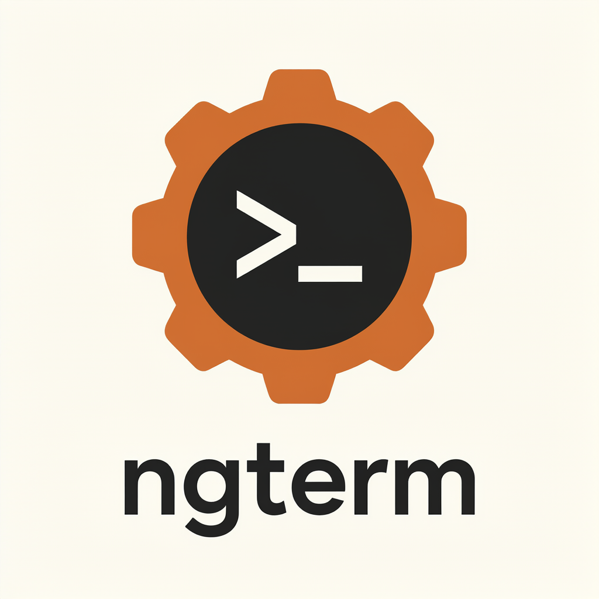
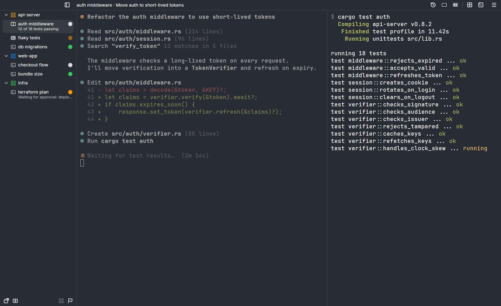

<h1 align="center"></h1>

<p align="center"><strong>A fast, scriptable terminal for running many coding agents at once.</strong></p>

<p align="center">Linux · Windows · macOS · with companion apps for Android and iOS</p>

<p align="center">
  <a href="https://github.com/nickalie/ngterm/releases/latest"></a>
  <a href="LICENSE"></a>
</p>

<p align="center"></p>

Run three or four coding agents and a row of tabs stops helping: which one finished, which one is stuck, which one is
waiting for your answer? ngterm gives every agent a named session, groups sessions into workspaces, and shows at a
glance who needs you. Your sessions keep running when you quit or update the app, and you can pick them up from
another computer or your phone.

## What you get

**See who needs you.** Claude Code, Codex, Pi and OpenCode report whether they are working, blocked or done, right on
their row in the sidebar. Jump straight to whatever needs attention, or watch several sessions at once in the
dashboard.

**Sessions that outlive the app.** With Live sessions on, you can quit, update or relaunch ngterm while your programs
keep running, an agent in the middle of a task included. The next launch brings them back exactly as they were. Works
with bash, zsh, fish and PowerShell.

**Your work on any machine.** Attach a session running on another computer as a row in your own sidebar, status and
notifications included. A server with no display can host sessions too.

**Your agents on your phone.** The Android and iOS apps connect over ssh to view and drive your sessions. A pane
running Claude Code or Codex can appear as a chat: send prompts, answer permission requests and attach photos or files
from your phone.

**Organized, with nothing extra to learn.** Workspaces hold sessions, sessions can split in two, and that is the whole
model. A scratch terminal, floating overlays, and companion sessions that stay pinned under their parent cover the
rest.

**More than text.** Open images, Markdown, source files, diffs, live-following logs and full HTML pages over a session.
Click a file path in the terminal and it opens right there.

**Scriptable from end to end.** `ngtermctl` drives almost everything: create sessions, type into them, ask a question
in a dialog, post a notification, wait for an agent to finish. Install the agent skill, and your agent can arrange its
own workspace. Agents can even send each other messages.

**Built on Ghostty.** Terminal emulation comes from [Ghostty](https://ghostty.org)'s engine, drawn with the GPU. Your
Ghostty config and its full theme catalog work here too.

## Install

Download the latest version from the **[Releases page](https://github.com/nickalie/ngterm/releases/latest)**:

| Platform | Download |
|---|---|
| **Linux** (x86_64, arm64) | `.deb`, `.rpm`, Arch `.pkg.tar.zst`, `.AppImage` or portable `.tar.gz` |
| **Windows** (x86_64) | `.msi` installer (no admin rights needed) or portable `.zip` |
| **macOS 14+** (Apple Silicon, Intel) | `.dmg`, `.pkg`, `.app.zip` or `.tar.gz` |
| **Android 8.0+** | `.apk` |
| **iOS 26+** | `.ipa`, unsigned |

Good to know before you start:

- **Linux** needs Ubuntu 24.04 or newer, or a current Debian, Fedora, Arch or openSUSE, plus a Vulkan graphics driver.
  HTML pages need a web engine: ngterm uses your system's if it is recent enough, and otherwise downloads one (about
  120 MB) the first time you open a page.
- **macOS** needs a Metal-capable Mac. Builds are not notarized yet, so the first launch may need your approval under
  System Settings ▸ Privacy & Security.
- **Windows** installers are not signed yet, so SmartScreen may warn you.
- **Android** asks you to allow installs from the source you downloaded the `.apk` with.
- **iOS** builds on the Releases page have to be re-signed before they install, with a sideloading tool or your own
  Xcode team.

ngterm downloads updates in the background and offers **Install Update** in the title bar, unless you turn that off in
Settings ▸ General ▸ Updates. `.deb`, `.rpm`, Arch package and macOS `.pkg` installs ask for your password when you
press it. The Android app notifies you when a new release is out and installs it from Settings ▸ Updates. To verify a
download, see [release signing](docs/release-signing.md).

## Get started

1. **Learn a few keys.** These are the defaults on Linux and Windows. On macOS, the menus show each command's key.

   | | Shortcut |
   |---|---|
   | New session | <kbd>Ctrl</kbd>+<kbd>Shift</kbd>+<kbd>T</kbd> |
   | New workspace | <kbd>Ctrl</kbd>+<kbd>Shift</kbd>+<kbd>W</kbd> |
   | Split the session | <kbd>Ctrl</kbd>+<kbd>Shift</kbd>+<kbd>D</kbd> |
   | Scratch terminal | <kbd>Ctrl</kbd>+<kbd>Shift</kbd>+<kbd>J</kbd> |
   | Dashboard | <kbd>Ctrl</kbd>+<kbd>Shift</kbd>+<kbd>M</kbd> |
   | Jump to a session | <kbd>Ctrl</kbd>+<kbd>P</kbd> |
   | Everything else, in the command palette | <kbd>Ctrl</kbd>+<kbd>Shift</kbd>+<kbd>P</kbd> |

2. **Connect your agents.** On first launch, ngterm offers to install the agent skill and the agent status hooks.
   Accept, then start a new agent, and its status shows up in the sidebar. Both are also in the **Help** menu. With the
   skill installed, you can ask your agent to split panes, show a page or build you a shortcut.
3. **Turn on Live sessions.** Set **Settings ▸ General ▸ Restore sessions** to **Live sessions**, then restart ngterm.
4. **Want `ngtermctl` outside ngterm?** It already works in ngterm's own terminals. Linux packages and the Windows
   installer also put it on your `PATH`. Everywhere else, choose **Help ▸ Install Command Line Tool…**.

Keys, hooks and the terminal itself are all configurable, in `keymap.conf`, `hooks.conf` and `ghostty.conf`. You will
find them in `~/.config/ngterm` on Linux and macOS and in `%APPDATA%\ngterm` on Windows.

## Script it

Everything you can do with the mouse, a script or an agent can do with `ngtermctl`:

```sh
id=$(ngtermctl session new --name review --cwd ~/project --command claude)
ngtermctl session wait --target "$id" --until completed
ngtermctl notify --target "$id" --title "Review" "Finished, take a look"
ngtermctl ask open "Deploy to staging?" --button yes --button no
```

Run `ngtermctl --help` for the full list.

## Work from another machine

Any computer running ngterm can share its Live sessions over ssh. On your desktop, list the machine in `remotes.conf`
(one `destination [label]` per line, with key-based ssh set up), then choose **File ▸ Attach Remote…**.

On a phone, the app creates an ssh key on first launch and shows the line to add to `~/.ssh/authorized_keys` on each
machine. Then add the machine by host, port and user.

You can attach to Linux, macOS and Windows machines, from a Linux, macOS or Windows desktop or from the phone app. A
Windows machine needs Windows' OpenSSH server, with key-based ssh set up for your account; a Windows desktop uses the
`ssh` on its `PATH`, Windows' own OpenSSH client by default.

A Mac running [agterm](https://github.com/umputun/agterm) in Live sessions mode works too, from every desktop and the
phone app: ngterm finds out which app answers, and the desktop marks those sessions **agterm** in the title bar. They
lack what is ngterm's own: the agent chat view (the phone app says so when you open one), Kitty clipboard paste, renames
made on that Mac and page companions it opens later. When a Mac runs both apps, ngterm answers first; write
`agterm:HOST` in `remotes.conf` to reach its agterm instead. A session keeps the app it was attached from, after a
relaunch too.

### A server without a display

To host sessions on a machine with no screen, install ngterm there and run its windowless version:

```sh
ngterm-headless --detach   # keeps running after you log out
```

Give it a few seconds to start, then create a session to attach to:

```sh
ngtermctl session new --name build
```

`ngtermctl` has to be on the `PATH` of ssh logins. The `.deb`, `.rpm`, Arch and Windows `.msi` packages take care of
that, and a portable Windows folder adds itself the first time `ngterm-headless` starts there. With a portable or macOS
install, link `ngtermctl` into `~/.local/bin` or `/usr/local/bin`. On Windows, Task Scheduler can run
`ngterm-headless --detach` at logon so the server comes back after a reboot. ngterm sets up the agent skill and status
hooks on the server each time it starts, so agents you run there report their status too.

## Troubleshooting

### Selected text is not on the clipboard

Selecting text doesn't touch the system clipboard. Middle-click pastes the selection, and
<kbd>Ctrl</kbd>+<kbd>Shift</kbd>+<kbd>C</kbd> (<kbd>⌘</kbd><kbd>C</kbd> on macOS) copies it. To also copy every
selection to the clipboard, add `copy-on-select = both` to your config.

### WebKit sandbox on Ubuntu (AppArmor)

Ubuntu 23.10 and later refuse HTML pages until ngterm's AppArmor profile is installed. The `.deb` package does this for
you. For an AppImage or a tarball, follow
[these steps](docs/development.md#webkit-sandbox-on-ubuntu-apparmor).

### Something else

Please [open an issue](https://github.com/nickalie/ngterm/issues). The log is `ngterm.log` in ngterm's state directory:
`~/.local/share/ngterm` on Linux and macOS, and `%LOCALAPPDATA%\ngterm` on Windows.

## Build from source and contribute

Build instructions, tests, architecture and internals are in the
[technical reference](docs/development.md).

## Credits

ngterm is a Rust port of [agterm](https://github.com/umputun/agterm) by Umputun, and it stands on
[Ghostty](https://ghostty.org)'s terminal engine, [GPUI](https://gpui.rs) from Zed, and
[herdr](https://github.com/herdrdev/herdr)'s session server. Third-party notices are in [NOTICE](NOTICE).

Released under the [MIT License](LICENSE).
